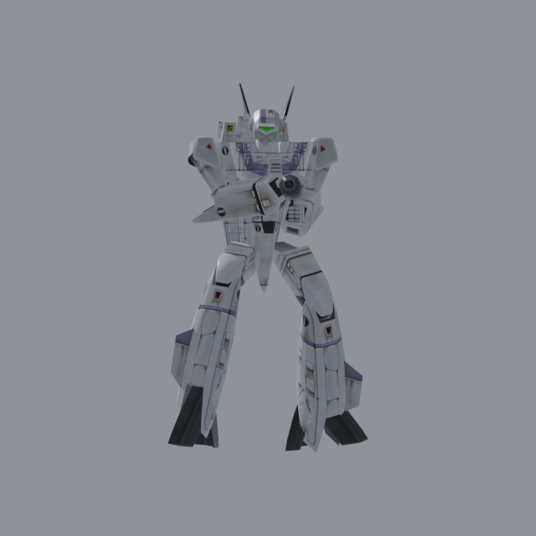
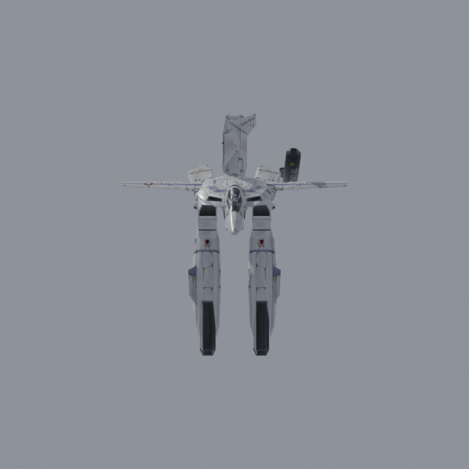
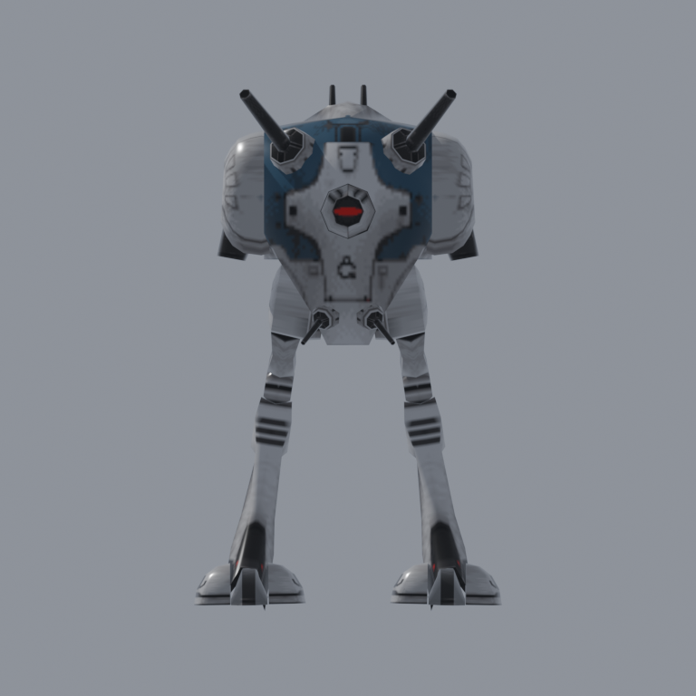
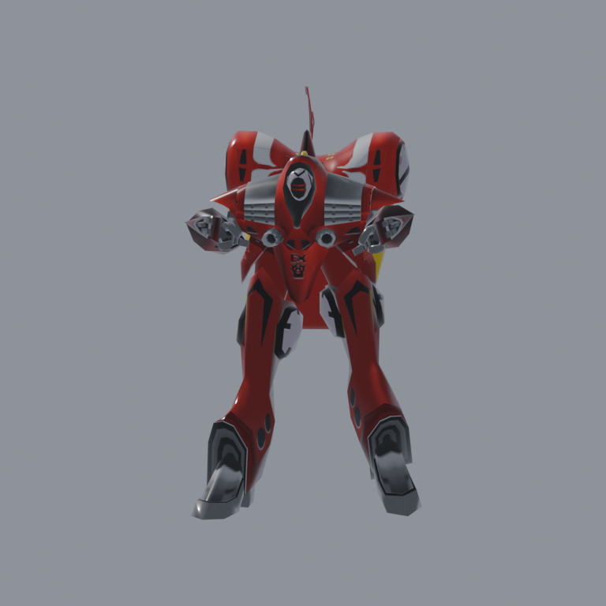
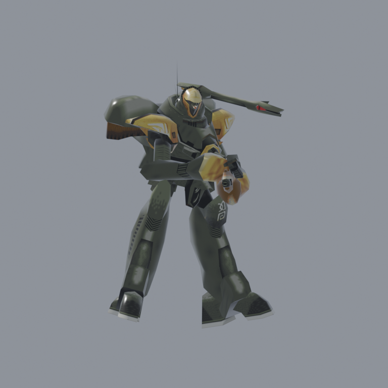
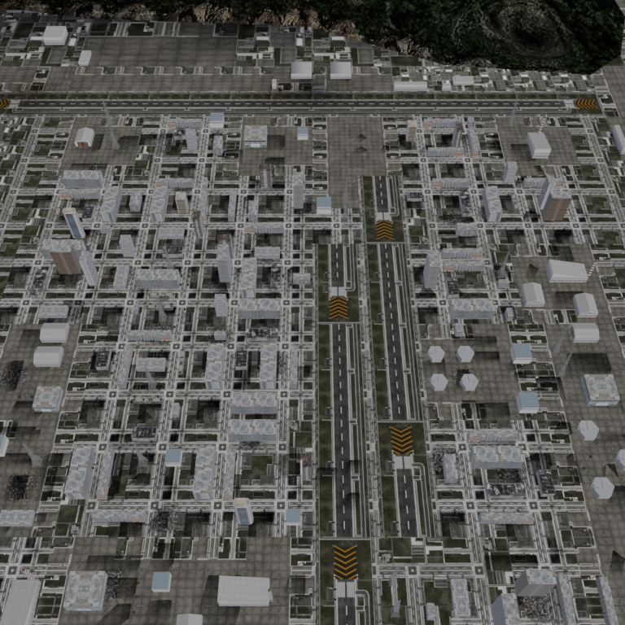

# Macross SDF Importer for Blender 5.2

> [!NOTE]
> **Related project:** [Tzeentchnet/SDF_Macross — Vulkan PC static recompilation research for *Chou Jikuu Yousai Macross* (PS2)](https://github.com/Tzeentchnet/SDF_Macross)

This add-on imports models, materials, textures, skeletal motions and stages
from **Chou Jikuu Yousai Macross** (PS2, Japan, `SLPM-65405`). It reads
straight from your own disc image or from extracted files.

- **Models:** GFX2OBJ `0100`/`0200` (all 7,989 on the disc). The node hierarchy becomes an armature, with one welded mesh per model, custom normals and game vertex colours.
- **Textures:** TIM2 4/8-bit, GS-unswizzled with numpy, packed directly into the .blend. Liveries via the `*_COL_nn` sets.
- **Materials:** Principled (lit) or Emission (prelit/unlit), using diffuse/emission colour attributes, alpha and blending taken from the game data.
- **Motions:** `.mot` clips on `.bon` skeletons with the game's own FK + IK solver. Each clip becomes one slotted action and NLA track. Fighter ↔ Gerwalk ↔ Battroid transformations, Battroid/enemy IK walk cycles, and event clips (*Motions onto Rig*) are supported.
- **Stages:** `GD_xx` ground tile grids, object arrangements, fixed scenery and sky, instanced as linked duplicates.

The game data is not included. You need your own disc image.

## Visual examples

All of these Blender renders use assets imported from the user's own game
data.

### Models and motion

| VF-1J Battroid | Fighter to Gerwalk transformation |
|:---:|:---:|
|  |  |
| Rigged model in a neutral action pose | Imported transformation motion at an intermediate frame |

### Enemy assets

| Regult | Queadluun-Rau | Nousjadeul-Ger |
|:---:|:---:|:---:|
|  |  |  |

### Stages



*Macross City assembled from the imported ground grid, object placements and
linked scenery instances.*

## Install

Copy or zip the `io_import_macross_sdf` folder, then in Blender 5.2 use
*Edit › Preferences › Get Extensions › Install from Disk*. Alternatively,
symlink it into
`%APPDATA%\Blender Foundation\Blender\5.2\extensions\user_default\`.

In the add-on preferences, set **Disc image** to your ISO. The importer then
pulls shared skeletons and motion sets (e.g. `MOT_BAT_VF1.MRG`) automatically.

## Use

*File › Import*:

| entry | use |
|---|---|
| Macross SDF from Disc Image | pick e.g. `BIN.CVM/VF1J_AC.CMP` (VF-1J), `BIN.CVM/ENM_GLG.CMP` (Glaug) or `BIN.CVM/GD_01.CMP` (Macross City) |
| Macross SDF Asset (.cmp/.mrg) | an extracted file |
| Macross SDF Motions onto Rig | with an imported armature active, add clips from `MOT_*`, `AUTH_*` or `*_AC` archives |

Clips appear as NLA tracks on the armature; un-mute a track or pick its
action in the Action Editor. The scene runs at 60 fps.

## Repository layout

```
io_import_macross_sdf/   the add-on (formats/ is Blender-free and usable as a library)
docs/                    format specifications, research log, open issues
tools/                   survey, headless Blender tests, VU0 disassembly helper
```

Start with [docs/README.md](docs/README.md).

## Build the extension zip

```
"D:\Blender Foundation\Blender 5.2\blender.exe" --command extension build --source-dir io_import_macross_sdf --output-dir dist
```

## License

GPL-3.0-or-later, as declared in `blender_manifest.toml`. The CRICMP
decompressor is a Python port of the token logic in the LGPL-2.1
[`zeesworth/cricmp`](https://github.com/zeesworth/cricmp) decoder.
